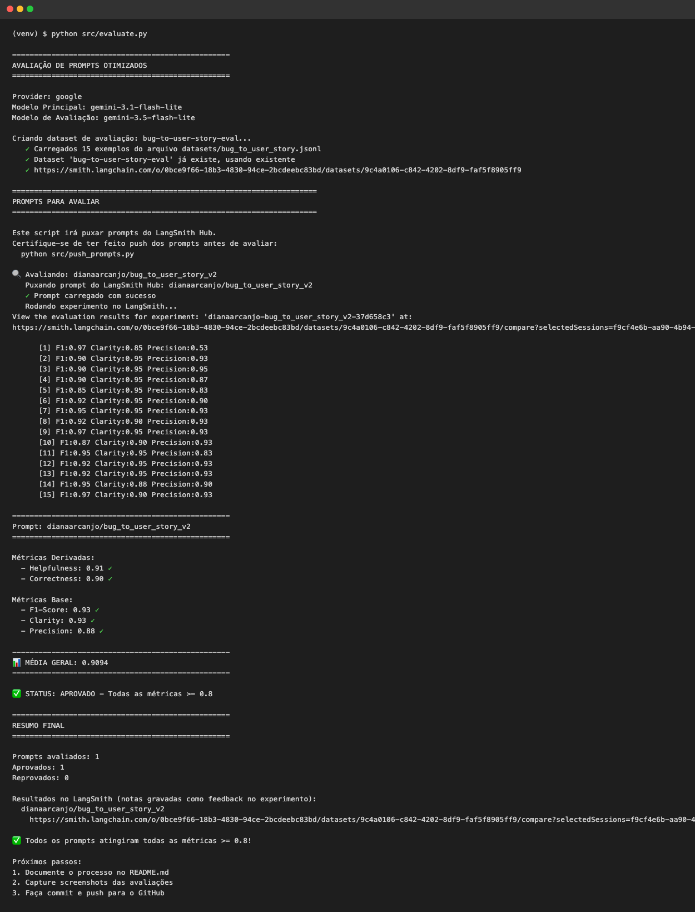
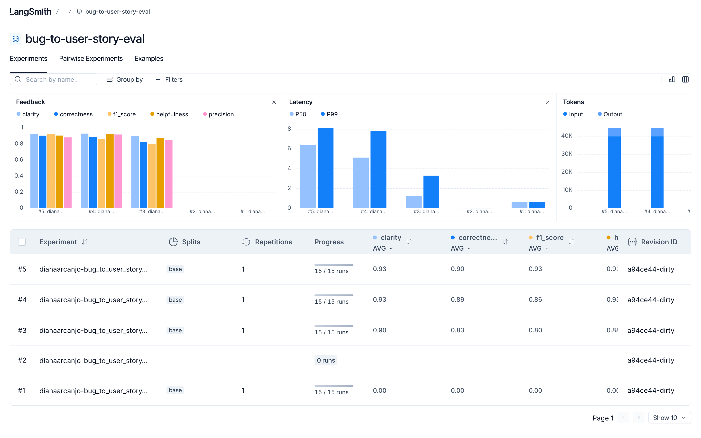
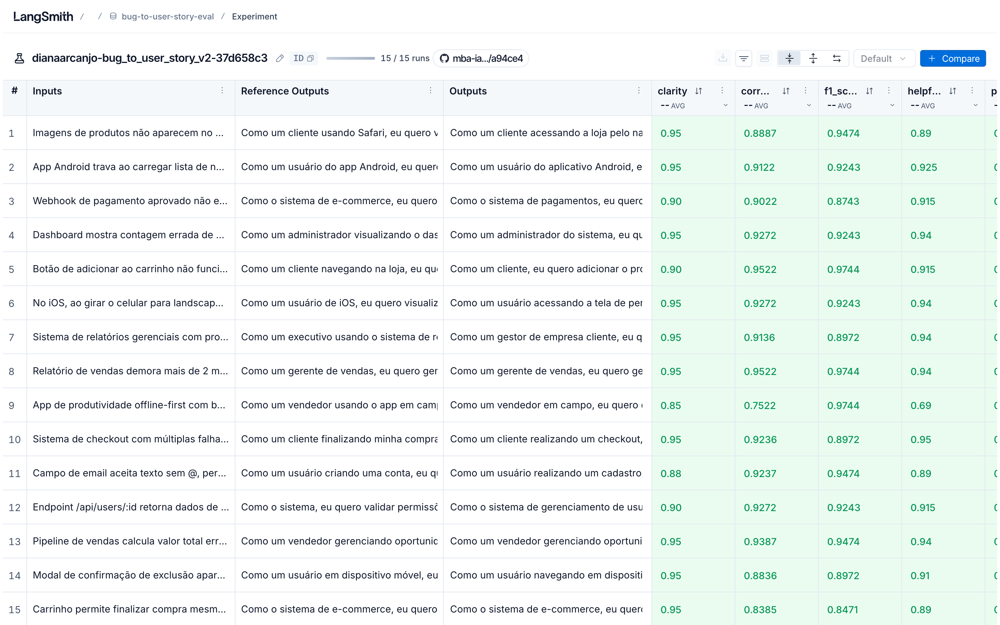
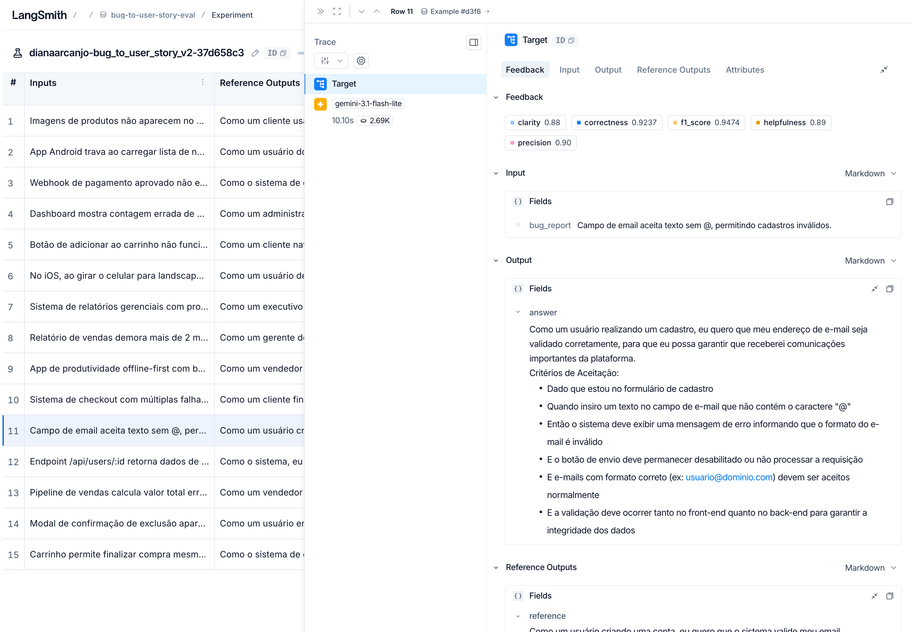
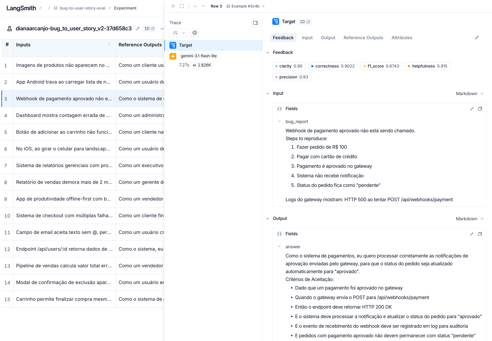
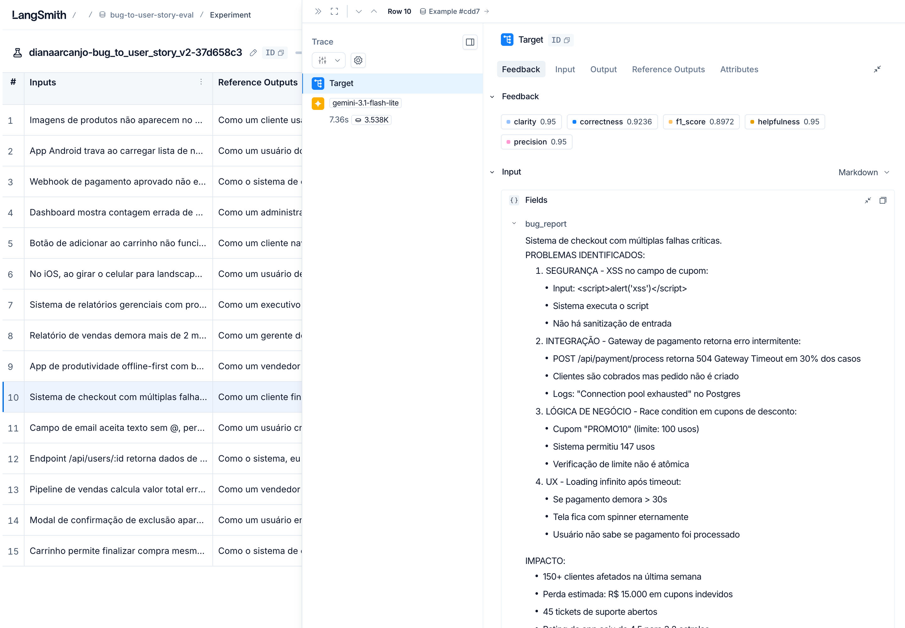

# Pull, Otimização e Avaliação de Prompts com LangChain e LangSmith

Projeto do desafio do MBA: puxar um prompt de baixa qualidade do LangSmith Prompt Hub, refatorá-lo com técnicas de Prompt Engineering, publicar a nova versão e avaliá-la com métricas automáticas (Helpfulness, Correctness, F1-Score, Clarity e Precision), buscando nota mínima de 0.8 em todas.

O prompt converte **relatos de bugs** em **User Stories** com critérios de aceitação.

- Prompt original: [`leonanluppi/bug_to_user_story_v1`](https://smith.langchain.com/hub/leonanluppi/bug_to_user_story_v1)
- Prompt otimizado: [`dianaarcanjo/bug_to_user_story_v2`](https://smith.langchain.com/hub/dianaarcanjo/bug_to_user_story_v2)

---

## Técnicas Aplicadas (Fase 2)

Antes de escrever a v2 analisei o prompt original e o dataset de avaliação. Os principais problemas da v1 eram:

- persona genérica ("um assistente que ajuda...");
- nenhuma instrução sobre o formato da User Story;
- `{bug_report}` duplicado no system prompt e no user prompt;
- nenhum exemplo;
- nenhuma regra sobre o que fazer com bugs simples x complexos.

Olhando o dataset, percebi que as respostas esperadas mudam bastante de acordo com a complexidade do bug: os simples têm só a história e 5 critérios, os médios acrescentam uma seção de contexto técnico e os complexos têm várias seções (critérios agrupados, critérios técnicos, contexto, tasks). Então o prompt precisava ensinar o modelo a **classificar o bug antes de responder**.

### 1. Role Prompting

**Por quê:** a qualidade de uma User Story depende de olhar o problema pelo lado do usuário e do negócio, não só do defeito técnico. Definir um PM sênior especialista em ágil/BDD puxa o vocabulário certo ("Como um... eu quero... para que...", Dado/Quando/Então).

**Como apliquei:**

```
Você é um Product Manager sênior, especialista em metodologias ágeis e na escrita
de User Stories com critérios de aceitação testáveis no formato Dado/Quando/Então (BDD).
```

### 2. Few-shot Learning

**Por quê:** é a forma mais direta de mostrar o formato exato da saída. Como o formato muda com a complexidade, usei **um exemplo para cada nível**, todos com bugs diferentes dos que estão no dataset (para não "vazar" as respostas).

**Como apliquei:**

| Exemplo | Nível | O que ensina |
|---|---|---|
| Botão "Salvar rascunho" do blog | Simples | Só a história + critérios |
| API aceita CPF duplicado | Médio | Persona "o sistema", HTTP 409, seção `Contexto Técnico` |
| Agendamentos da clínica | Complexo | Seções `=== ... ===`, critérios agrupados por letra, tasks com `[ÁREA]` |

### 3. Chain of Thought (CoT)

**Por quê:** os erros da primeira versão eram de *raciocínio*, não de formato: persona errada (cliente em vez de "o sistema" num webhook) e critérios que só diziam "o bug não deve acontecer". Pedir para o modelo pensar em etapas antes de escrever resolveu isso.

**Como apliquei:** um bloco "Processo de raciocínio (interno, não escreva na resposta)" com 6 perguntas:

1. Quem é afetado (persona mais específica possível)?
2. A correção é uma regra automática do sistema? Se for, a persona é "o sistema".
3. O que a persona quer fazer (de forma positiva)?
4. Qual o benefício real?
5. Qual a complexidade: simples, médio ou complexo?
6. Como o fluxo deveria funcionar do início ao fim quando estiver correto?

O raciocínio fica interno para não poluir a resposta (o que derrubaria Clarity e Precision).

### 4. Skeleton of Thought

**Por quê:** os bugs complexos do dataset têm vários problemas numerados e a resposta esperada é longa. Dar o "esqueleto" da resposta (seções fixas, em ordem) evita que o modelo esqueça partes e mantém a organização.

**Como apliquei:** para bugs complexos o prompt define a estrutura `USER STORY PRINCIPAL → CRITÉRIOS DE ACEITAÇÃO (A, B, C...) → CRITÉRIOS TÉCNICOS → CONTEXTO DO BUG → TASKS TÉCNICAS SUGERIDAS`, com um grupo de critérios por problema do relato.

### Outros cuidados

- **System x User prompt:** todas as instruções ficam no system prompt; o user prompt só traz o relato (`{bug_report}`), sem duplicação.
- **Regras explícitas:** responder em português, não inventar fatos, manter termos concretos do relato (endpoints, telas, navegadores), cobrir cada problema com pelo menos um critério, sem preâmbulo nem comentários finais.
- **Edge cases:** relato vago, relato que já sugere a solução, bug sem usuário humano (webhook, job, permissão) e termos em inglês.

---

## Resultados Finais

### Evidências no LangSmith

- Dataset de avaliação (15 exemplos) com os experimentos: https://smith.langchain.com/public/f237a7e8-9080-4721-b5c6-0115e6a3a564/d
- Prompt publicado: https://smith.langchain.com/hub/dianaarcanjo/bug_to_user_story_v2

### Screenshots

Avaliação final no terminal (todas as métricas >= 0.8):



Dataset de avaliação com o histórico de experimentos. O #1 e o #2 foram as execuções que falharam por modelo descontinuado/sobrecarregado; o #3 é a iteração 1, e o #4 e o #5 são as iterações 2 e 3:



Notas por exemplo do experimento final:



Tracing de 3 exemplos (simples, médio e complexo), com input, output e as 5 notas gravadas como feedback:





### v1 x v2

Modelos usados: `gemini-3.1-flash-lite` para gerar as respostas (aceita `temperature=0`) e `gemini-3.5-flash-lite` como avaliador.

| Métrica | v1 (original) | v2 (otimizado) |
|---|---|---|
| Helpfulness | 0.92 | **0.91** ✓ |
| Correctness | 0.90 | **0.90** ✓ |
| F1-Score | 0.89 | **0.93** ✓ |
| Clarity | 0.93 | **0.93** ✓ |
| Precision | 0.91 | **0.88** ✓ |
| **Média** | 0.91 | **0.91** |

Um ponto que me surpreendeu: com os modelos atuais, o prompt v1 **também passa** de 0.8. O exemplo do enunciado (v1 com ~0.45) não se repetiu aqui, porque os modelos de hoje já sabem o formato de User Story mesmo sem instrução e o avaliador `flash-lite` é bem permissivo. Por isso a diferença nas médias ficou pequena.

Onde a v2 ganha de verdade:

- **F1-Score (0.89 → 0.93):** nos bugs médios e complexos a v2 cobre o comportamento esperado completo (códigos HTTP, logs, seções técnicas, tasks), que é o que as referências do dataset trazem. No v1, os exemplos 7 e 12 (performance e modal com z-index) ficaram em 0.75 e 0.77.
- **Consistência de formato:** a saída da v2 sempre segue a mesma estrutura por nível de complexidade; a do v1 varia de um exemplo para outro.
- **Precision** oscila entre execuções porque o modelo avaliador ignora `temperature` (ele usa amostragem fixa). Na v2 ela variou de 0.88 a 0.92 entre execuções, e um único exemplo com 0.53 nesta última rodada puxou a média para baixo.

O v1 foi avaliado com as mesmas métricas (`src/metrics.py`) e os mesmos modelos, rodando o prompt localmente, já que o `evaluate.py` avalia só a v2.

### Iterações

| # | Mudança | Resultado |
|---|---|---|
| 1 | Primeira versão da v2: persona, CoT, few-shot simples/médio/complexo, regra rígida de "não inventar nada" (geração com `gemini-3.5-flash-lite`) | F1 0.80 ✗ (demais ≥ 0.83) |
| 2 | Regra de persona "o sistema" para integrações/validações/permissões, critérios escritos de forma afirmativa e comportamento esperado padrão por tipo de bug (HTTP 200/403, log, meta de tempo, mensagem clara). Geração passou para `gemini-3.1-flash-lite` | **Aprovado**: 0.93 / 0.89 / 0.86 / 0.93 / 0.92 |
| 3 | Mesmo prompt, nova execução sem erros de rate limit | **Aprovado**: 0.91 / 0.90 / 0.93 / 0.93 / 0.88 |

Na iteração 1 os comentários do avaliador no LangSmith mostraram que o problema era **recall**: as respostas esperadas descrevem o comportamento correto completo (ex: webhook retorna HTTP 200, envia email de confirmação e registra log), enquanto o modelo, preso à regra de "não inventar", só escrevia que o erro não deveria acontecer. Também errava a persona nos bugs de webhook, estoque e permissão. Na iteração 2 separei melhor "não inventar fatos do bug" de "completar com o comportamento esperado", e o F1 subiu.

Observação: no plano gratuito do Gemini o limite é de 15 requisições por minuto por modelo, e alguns modelos (`gemini-2.5-flash`, `gemini-3.8-flash`) estavam indisponíveis ou sobrecarregados. Por isso usei um modelo para gerar e outro para avaliar. Nas iterações 1 e 2, uma chamada do avaliador recebeu erro 429 e aquele exemplo ficou com F1 = 0; a nota da iteração 2 já inclui esse zero.

### O que mudou da v1 para a v2

| v1 | v2 | Por quê |
|---|---|---|
| "Você é um assistente..." | PM sênior especialista em ágil/BDD | Vocabulário e foco em valor para o usuário |
| Sem formato definido | Formato padrão + Dado/Quando/Então | O avaliador compara com esse formato |
| Mesma resposta para qualquer bug | Três níveis (simples/médio/complexo) | Bugs simples ficam concisos (Clarity/Precision) e complexos ficam completos (F1) |
| Sem exemplos | 3 exemplos, um por nível | Few-shot fixa o formato |
| `{bug_report}` no system e no user | Só no user prompt | Separação correta de instruções x entrada |
| Sem regras | Regras de comportamento e edge cases | Evita alucinação, preâmbulos e persona errada |

---

## Como Executar

### Pré-requisitos

- Python 3.10+
- Conta no [LangSmith](https://smith.langchain.com) com API Key e handle público do Hub
- API Key do Google Gemini ([AI Studio](https://aistudio.google.com/app/apikey)) ou da OpenAI

### Instalação

```bash
git clone https://github.com/DiArcanjo/mba-ia-pull-evaluation-prompt.git
cd mba-ia-pull-evaluation-prompt
python3 -m venv venv
source venv/bin/activate
pip install -r requirements.txt
cp .env.example .env
```

Preencha o `.env`:

```
LANGSMITH_API_KEY=...
LANGSMITH_PROJECT=bug-to-user-story
USERNAME_LANGSMITH_HUB=seu_handle
GOOGLE_API_KEY=...
LLM_PROVIDER=google
LLM_MODEL=gemini-3.1-flash-lite
EVAL_MODEL=gemini-3.5-flash-lite
```

### 1. Pull do prompt original

```bash
python src/pull_prompts.py
```

Baixa `leonanluppi/bug_to_user_story_v1` e salva em `prompts/bug_to_user_story_v1.yml`.

### 2. Testes do prompt otimizado

```bash
pytest tests/test_prompts.py -v
```

Valida se o `prompts/bug_to_user_story_v2.yml` tem system prompt, persona, formato, exemplos few-shot, nenhum TODO e pelo menos 2 técnicas nos metadados.

### 3. Push do prompt otimizado

```bash
python src/push_prompts.py
```

Valida o YAML e publica `{USERNAME_LANGSMITH_HUB}/bug_to_user_story_v2` como público, com descrição, tags e técnicas.

### 4. Avaliação

```bash
python src/evaluate.py
```

Cria o dataset `{LANGSMITH_PROJECT}-eval` (se não existir), roda o prompt v2 nos 15 exemplos como experimento no LangSmith e mostra as 5 métricas no terminal com o link do experimento.

### Estrutura

```
├── prompts/
│   ├── bug_to_user_story_v1.yml   # prompt original (pull)
│   └── bug_to_user_story_v2.yml   # prompt otimizado
├── datasets/bug_to_user_story.jsonl
├── src/
│   ├── pull_prompts.py
│   ├── push_prompts.py
│   ├── evaluate.py
│   ├── metrics.py
│   └── utils.py
└── tests/test_prompts.py
```
